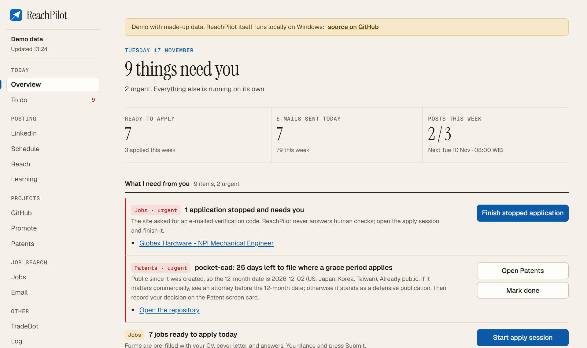

<p align="center">
  <a href="https://github.com/juw12/reachpilot"></a>
</p>

<p align="center">
  <b>Turns your GitHub into a posting schedule.</b><br>
  For developers who ship side projects but never get round to posting them. ReachPilot writes each post from
  your repo's real facts, adds a short demo video of the product being used (or a fresh screenshot), posts it
  through LinkedIn's official API, cuts it to fit Bluesky,
  Mastodon, Dev.to, and X, Threads and Substack (free through Buffer), and learns which projects people click.
</p>

<p align="center">
  <a href="https://github.com/juw12/reachpilot/actions/workflows/tests.yml"></a>
  
  
  
</p>

<p align="center"><a href="https://juw12.github.io/reachpilot/"><b>Try the live demo</b></a> (the real dashboard with made-up data)</p>

<p align="center"></p>

**Safe by design:** official Share on LinkedIn API only (no scraping, no browser bots, no auto-likes), every number in a
post must exist in your repo, and everything (tokens, history, drafts) stays on your PC in git-ignored files.

## Why

I build a lot of side projects. Writing a LinkedIn post for each one, finding a screenshot, picking a time, then doing
it again next week for the older ones: that's the part that never happens. ReachPilot does it for me, without making anything up.

## What it does

Every 30 minutes, Windows Task Scheduler runs one pass:

1. **Watches GitHub** through the `gh` CLI: new public repos, new releases, real commit activity.
2. **Picks what to post** in the next slot (Tue/Wed/Thu 08:00 by default), in this order:
   new repo → new release → your hand-written queue → active-repo update → top-performer roundup → an older project from a fresh angle.
3. **Writes the post from facts only**: README tagline and feature bullets, description, topics, commit messages.
   A guard rejects any number that isn't in the source. No invented users, stars or backstory.
4. **Adds real visuals**: a short demo video of the product being used, recorded fresh from the live site
   (8 to 22 seconds: it looks, presses a few controls, scrolls through and comes back up), posted natively on
   LinkedIn and every platform that takes video. The recording only reads the site: every request that is not
   a GET is blocked and sign-in, pay, delete and download buttons are never pressed. A project without a
   live site still gets a video (see [A video for every post](#a-video-for-every-post)); a platform that
   refuses the video gets a fresh screenshot plus media from the README instead. Switch the video off with
   `"demo_video": false` in `config.json`.
   The recording is then cut into a short vertical video that opens with a hook
   (see [Short videos](#short-videos-that-open-with-a-hook)).
5. **Never repeats itself**: four angles (launch, one-feature deep dive, behind the build, ask for feedback),
   different README facts each time, a 21-day cooldown per project and a similarity cap against every past post.
   If nothing fresh qualifies, it skips the slot instead of reposting.
6. **Learns what lands**:
   - visitors GitHub attributes to linkedin.com / lnkd.in (repo traffic API),
   - stars gained in the week after a post,
   - "Try it" clicks: site links go through `<you>.github.io/go/<project>/`, a tiny page that counts the click with
     [GoatCounter](https://www.goatcounter.com) and forwards in well under a second.

   Projects and angles are then chosen with Thompson sampling: winners get posted more, untested ones still get a turn.

It also repairs garbled characters in READMEs (text saved in the wrong encoding), skips install/run steps when picking
feature bullets, and puts links in the first comment.

### Short videos that open with a hook

A plain screen recording gets scrolled past. So the recording is taken again at phone size, placed in a phone
frame and cut into a 15 to 18 second vertical video built the way short videos that hold attention are built:
a hook in the first 3 seconds, big captions (most people watch muted), a progress bar, and an end card that
says "Star it on GitHub" with the repo address. With the voice installed, a natural voice reads the captions
aloud (see [Voice-over](#voice-over)).

| Format | Opens with | Then |
|---|---|---|
| **Hook** | a scroll-stopper: "Still doing this the hard way?", "Nobody asked for this. I built it anyway." | what the project is, its strongest features |
| **POV** | "POV: you just found <project>" | a first look, as if you opened it yourself |
| **Question** | what a viewer would ask: "what does it even do?", "is it really free?", "where's the code?" | the answer, then the demo |
| **3 things** | "3 things about <project>" | three features from the README, numbered 1, 2, 3 |
| **Speedrun** | "<project> in 15 seconds" | fast cuts, short captions |
| **Film** | "Meet <project>." | the product in use on a near-black backdrop, a few plain white lines that fade, music instead of a voice |

- **Which format** is chosen per post: never the format of the previous video, never the one this project had
  last time, a nudge for the format that suits the post's angle (a feedback post leans towards the question,
  a deep dive towards "3 things"), and Thompson sampling on what each format earned, so the formats that bring
  visitors and stars are used more and untested ones still get a turn.
- **Two cuts of every video**: 4:5 (1080 x 1350) for the feeds of LinkedIn, Bluesky, Mastodon, Telegram and
  Discord, and 9:16 (1080 x 1920) for X and Threads.
- **The hook also opens the post text**, so the post and the video pull the same way.
- **Hooks are curiosity, not lies.** Every caption comes from the repo's own description and README. There are
  no fake users, no made-up quotes or reviews and no numbers the repo doesn't state; "is it really free?" is
  only asked when the repo has a licence. A hook that carries a number the repo never states stays out of the post.
- A project with too little to say, or a failed render, falls back to the plain recording, and from there to
  screenshots.

#### Voice-over

Every video can carry a spoken voice: a neural voice (Kokoro) that runs on your own PC. No account, no cloud,
no cost, and nothing leaves the machine.

- **It reads the captions, nothing else.** The voice says exactly what the video shows; it never adds a word.
  Web addresses stay on screen and are not read out.
- **The captions stay**, because most people still watch muted. Each caption now stays up for as long as its
  line takes to say, so a voiced video is as long as its script takes to read. The speedrun stays
  15 seconds: its lines are read a little faster when they have to be, never faster than 1.3x.
- **The end card says "AI voice-over"** in small print, so nobody takes the voice for a person.
- **It never blocks a post.** When the voice is not installed, is switched off, or fails on a video, that
  video is made silent, exactly as before, and the log says why. The same goes for a voice that is too
  slow: on a busy PC it gets four minutes for a video, then the video goes out silent rather than late.
  The scheduled run also puts itself at normal priority (Task Scheduler starts it lower), so that on a busy
  PC the voice takes about a minute and a half instead of twenty.

The film is never read aloud; it has [music](#music) instead.

The voice is optional and not part of `requirements.txt`. To switch it on:

```
pip install kokoro-onnx
```

then put `kokoro-v1.0.onnx` and `voices-v1.0.bin` (from the
[kokoro-onnx releases](https://github.com/thewh1teagle/kokoro-onnx/releases)) in a `models` folder next to
`autopilot.py`, or name their folder in `"voice_models"`.

#### Music

The film has no voice. It plays a short calm piece instead: soft mallet notes over a warm pad, a quiet pulse
that comes in with the first caption, and a last chord that lands on the end card and rings out.

- **Made on your PC, by `soundtrack.py`.** Nothing is downloaded and nothing is licensed, so there is no fee,
  no attribution and nothing a platform can mute or claim.
- **Each project has its own tune**: its key, chords and pattern come from its name, so a project sounds the
  same from one video to the next and different from the others.
- **Written to the video**: the bars end exactly where the end card starts.
- **It never blocks a post.** Playing the notes needs `numpy` (in `requirements.txt`); without it, or when
  it fails, the film goes out silent and the log says why.
- It is synthesized, not a studio recording. Listen to one film before you decide to keep it.

Settings in `config.json`:

| Key | Default | What it does |
|---|---|---|
| `demo_video` | `true` | `false` records no video at all |
| `video_formats` | all six | the formats in rotation; `[]` keeps the plain recording |
| `video_hook_in_post` | `true` | `false` leaves the post's first line alone |
| `video_hooks` | `{}` | your own hooks per project, for example `{"my-repo": ["Blackout tonight? Open {name}."]}` |
| `voice_over` | `true` | `false` keeps every video silent |
| `video_music` | `true` | `false` keeps the film silent |
| `video_voice` | a calm male blend | one Kokoro voice name, for example `"af_heart"`, or a blend such as `{"am_michael": 0.7, "am_fenrir": 0.3}` |
| `voice_models` | `models` | the folder that holds the two voice model files |
| `picture_every` | `5` | one post in this many leads with pictures instead of a video; `0` means never |
| `watch_pages` | `true` | `false` publishes no watch page |

The dashboard shows each post's video with its format, so you can see which one ran.

### A video for every post

Not every project has a site to record. What the video shows is chosen in this order:

1. **The project's own site**, used the way a visitor would use it.
2. **Its landing page** at `<you>.github.io/p/<project>/`, when one answers.
3. **A page ReachPilot builds itself** from the repo: name, description, the README's feature lines and
   pictures, the licence and the clone command. It is phone sized, exists only inside the recording browser
   and is never published.

For 2 and 3 the video is a tour of the project's page, not the product running, so the two hooks that say
you are watching it run ("POV: you try <project> for the first time", "ok but does it actually work?") are
left out for those projects.

- **Roundups** get one video for the whole post: a built page with a card per project, opening with
  "<N> projects I built" and ending on "See them all on GitHub".
- **Posts from your own queue** (`seed_queue.json`) get a video in front of the pictures you prepared, and
  their text is left exactly as you wrote it.
- **One post in five leads with pictures** (`picture_every`). Pictures can be read without pressing play, a
  feed of nothing but video looks the same every day, and the picture posts are the baseline that shows
  whether the videos really earn more visitors and stars. A picture post with no pictures gets the video anyway.

### Watch pages and creator credits

After a post about one project, its video also gets a page of its own at `<you>.github.io/watch/<project>/`:
the video on top, what the project does underneath, and a link to the repo. It is one address that plays the
demo, for anywhere a file can't be attached. Live pages are listed in `generated/watch_pages.json`.

When someone covers a project in a video or an article, record it on the dashboard's **Promote** page
("They covered it", then paste the link). The next post about that project thanks them by name with the link,
once, and they are listed on the project's watch page. ReachPilot never sends them a message or tags them;
it only writes the thank-you into your own post.

### Other platforms (free, official APIs)

Every LinkedIn slot also goes to the platforms you connect, each cut to fit from the same fact-checked post
(a platform can shorten a post, never add a claim):

| Platform | What it gets | You need |
|---|---|---|
| Bluesky | short post (300 characters), the demo video (or up to 4 screenshots), clickable link | your password once (setup turns it into an app password and stores only that) |
| Mastodon | short post (500 characters), the demo video (or screenshots) | an access token from your instance |
| Dev.to | an article for launches and releases (max one per project every 60 days), canonical URL back to you | an API key |
| Telegram | the full post with the demo video (or the first screenshot), in your own channel | a bot token + channel |
| Discord | the full post with the demo video (or the first screenshot), in your own server | a webhook URL |
| X | short post (280 characters as X counts them), the demo video (or the project's image), one link | a free Buffer account with your X connected, and a Buffer API key (Buffer publishes it, so no X API fees) |
| Threads | short post (500 characters), one topic tag, the demo video (or the project's image), one link | Threads connected in the same Buffer account (same API key) |
| Substack | a Substack Note with the post and links, the project's image | Substack connected in the same Buffer account (same API key) |

Each platform publishes and retries on its own (3 attempts within 3 days), so one platform failing never blocks
LinkedIn or the others. `preview` shows every platform's version.

X's own API now charges per post, so ReachPilot posts to X through [Buffer](https://buffer.com)'s free plan
and public API instead: Buffer is an official X partner and publishes the post to your account straight away,
at no cost. Buffer can't take local files, so the demo video is published at
`https://<you>.github.io/demo/<repo>.mp4` (your GitHub Pages repo, replaced at most every 60 days) and Buffer
fetches it from there for X and Threads. When that link isn't live yet, or Buffer refuses the video, the post
carries the README's first image (or GitHub's card for the repo). If you'd rather use the paid X API directly, type `api` at the setup prompt; those posts are capped
by `x_monthly_budget_usd` in `config.json` (about $0.20 per post with a link; default $5 a month).

Once a day `growth.py` grows the audience and points all of it at GitHub:

- **Profiles:** Mastodon bio plus link fields (GitHub, portfolio, Dev.to, Bluesky), featured hashtags and
  "discoverable"; Bluesky bio. Written from `profile` in `config.json`, and only pushed again when that block
  changes, so edits you make in the apps stay.
- **Pinned intro:** the first post on Mastodon and Bluesky is pinned to the profile.
- **Follow back:** new followers on Mastodon and Bluesky, at most 25 a day each, bots skipped.
- **GitHub profile:** your Mastodon, Bluesky and Dev.to accounts are listed on your GitHub profile (`socials` in
  the `profile` block), using the GitHub login Git already stores. GitHub marks those links `rel="me"`, which
  gives the GitHub link on your Mastodon profile a verified tick.
- **Measured:** posts per platform, follower counts (Mastodon, Bluesky, Dev.to, GitHub), and the GitHub visitors
  that came from LinkedIn, Mastodon, Bluesky, Dev.to, X, Threads, Substack, Telegram and Discord (repo traffic API).
  All show on the dashboard's "Every platform" table.
- **Recorded:** every change it makes is written to `growth_log` in `state.db` and counted on the dashboard
  ("Growth actions"), with details in the log file.
- **Readers of a project that counts its own:** a project can publish its numbers as a small `metrics.csv`
  (`date,subscribers,posts_counted,median_views,views_per_100_subscribers`) on a branch of its own repo. The
  dashboard reads it read-only (Morrow Brief: `juw12/morrow`, branch `social-data`) and shows, on Overview,
  today's subscribers, the typical views a post gets, and the gap to the target the project was given
  (250 by 31 Dec) with the pace the remaining days need. The plain link is tried first; where a proxy blocks
  `raw.githubusercontent` (the office network does), the same file is read through git into a small bare copy
  under `data/readers_cache/git/`. The last good copy is kept for an offline start, and the card says when it
  is showing the cache instead of live numbers.

It never follows, likes or replies to strangers automatically: Mastodon instances and Bluesky treat that as spam.

## What it deliberately doesn't do

- No browser automation, scraping, auto-likes or auto-comments on other people's posts. Only the official
  **Share on LinkedIn** API, so the account stays in good standing.
- No AI-invented claims. An optional local model (Ollama) can rephrase a post, but its output is rejected if it adds numbers.
- No silent failures: a LinkedIn login that is about to expire, a failed post or a draft waiting for review shows up
  on the dashboard's to-do list, and you get a Windows notification a week before the 60-day LinkedIn token runs out.

## Setup

You need Windows 10 or 11, Python 3.10+, Microsoft Edge (used for screenshots and the demo recording, so no browser download; `pip` brings its own
ffmpeg through `imageio-ffmpeg`),
the [GitHub CLI](https://cli.github.com/) and a free LinkedIn developer app.

```powershell
git clone https://github.com/juw12/reachpilot; cd reachpilot
pip install -r requirements.txt
notepad config.json                  # your GitHub user, time zone, posting slots, weekly cap, excluded repos
gh auth login                        # GitHub CLI: repos, READMEs and traffic
python autopilot.py init             # baseline your repos (+ optional seed_queue.json of hand-written posts)
python autopilot.py auth             # LinkedIn app with "Share on LinkedIn" + "Sign In with LinkedIn (OpenID)",
                                     # redirect URL http://localhost:8765/callback
python autopilot.py preview 5        # first result: the next 5 posts as drafts in drafts/, nothing is posted
python autopilot.py channels         # optional: connect Bluesky, Mastodon, Dev.to, Telegram, Discord, X (each verified)
python autopilot.py goatcounter      # optional: free GoatCounter site + token for "Try it" clicks
python autopilot.py install          # scheduled task \ReachPilot\LinkedIn posts: every 30 min + at sign-in
python selfupdate.py install         # optional: task \ReachPilot\Updates keeps the code current (fast-forward only)
                                     # and installs the packages a new version needs (missing ones only)
```

In `config.json`, `"mode": "auto"` posts by itself; set `"mode": "review"` to hold each draft until you run `approve`.

A repository whose name should not appear in this repository (a private one, for example) is excluded in a
git-ignored `config.local.json` instead of `config.json`: `{"exclude_repos": ["its-name"]}`. Only that list is
read from the file.

**Leak check.** `python leakcheck.py --history` looks for the name of every private repository of the last patent
scan in the tracked files and in every commit, and ends with an error when it finds one. It prints the place (a
file and a line, or a commit), never the name. The same check runs in CI against the repository secret
`PRIVATE_NAMES`, which the daily patent run refreshes (`python leakcheck.py --sync` does it by hand). In
`config.local.json`, `"leak_words"` adds your own words to the list and `"leak_accepted"` takes out a name you
decided to live with or an ordinary word.

### Create the LinkedIn app (once, about 5 minutes)

ReachPilot posts as you through your own free LinkedIn developer app; nobody else's server is involved.

1. Open [linkedin.com/developers/apps](https://www.linkedin.com/developers/apps) and press **Create app**. LinkedIn requires
   every app to be linked to a LinkedIn Page, so pick (or create) a Page you manage, then add an app name and logo.
2. On the **Products** tab, add **Share on LinkedIn** and **Sign In with LinkedIn using OpenID Connect**. Both are self-serve.
3. On the **Auth** tab, under *Authorized redirect URLs*, add `http://localhost:8765/callback` exactly.
4. Keep the Auth tab open: `python autopilot.py auth` asks for the **Client ID** and **Primary Client Secret** shown there,
   saves them to `secrets.json` (git-ignored), and opens LinkedIn so you can approve the scopes `openid profile w_member_social`.

The access token lasts 60 days and self-serve apps get no refresh token, so you sign in again every two months;
the dashboard and a Windows notification remind you a week before.

### What talks to what

| Service | Why | What is sent |
|---|---|---|
| GitHub | find repos, READMEs, commits, traffic | read-only requests through `gh` (public API as fallback) |
| LinkedIn | publish and measure posts | the post text, the demo video or images, and the first comment with links |
| Bluesky, Mastodon, Dev.to, Telegram, Discord (only those you connect) | publish the cut-down post | the post text, the demo video or screenshots, and links |
| Buffer (X, Threads, Substack, only those you connect) | publishes the cut-down post right away | the post text, the demo video URL or project image URL, and links |
| GoatCounter (optional) | count "Try it" clicks | a page view when someone opens a tracked go-link |
| Ollama (optional, local) | rephrase a post | nothing leaves your PC |

There is no ReachPilot server and no telemetry.

## Everyday use

| Command | What it does |
|---|---|
| `dashboard` | opens the local app (127.0.0.1 only): to-do list, schedule with post previews, every post's reach with links to it on each platform, followers and GitHub visitors per platform, what it changed on your accounts, GitHub visitors, stars, "Try it" clicks, what the bot has learned, and the log. It closes itself after 15 idle minutes. |
| `status` | token expiry, queue, recent posts, best performers, click counts |
| `preview 5` | write the next 5 posts to `drafts/` without posting |
| `approve` | in review mode, approve the waiting draft |
| `uninstall` | remove the `\ReachPilot\LinkedIn posts` task |

**Pause:** create an empty file named `PAUSE` in the ReachPilot folder (or press Pause on the dashboard); delete it to resume.
**Remove completely:** `python autopilot.py uninstall`, then
`Unregister-ScheduledTask -TaskPath '\ReachPilot\' -TaskName Updates` if you installed the updater, and delete the folder.

### The dashboard as a hub

The dashboard can also show other outreach automations. Personal ones (for example a job search) live in `modules/`,
which is git-ignored and never committed; the dashboard only shows a module that exists on disk. Every job runs from
Task Scheduler under `\ReachPilot\`, dashboard actions are whitelisted and need a per-session token from the same origin,
and **How it works** in the sidebar explains per module when it runs, what it does by itself and what it needs from you.
The pages are listed in a sidebar on the left (Today, Posting, Projects, Job search, Other); on a phone the sidebar
opens from the menu button. A page is listed only when its module is installed.

When the promotion module ships `listings.py`, the **Promote** page also tracks where each GitHub project is listed.
One config file names the projects and the places. Each place is either checked by itself (a public page or index
that needs no login), queued as one dated by-hand step a day, or held until the project has enough stars. Pull requests
to curated lists are capped at 5 a day (3 of them automatic), always say who the author is and that an AI
assistant helped, and the queue pauses once 3 of them are closed without merging. Sites behind a login, CAPTCHA or
bot check are never automated; they stay by-hand steps. The author's own setup (2026-11-14) tracks 53 places for
14 projects: 20 launch sites, 15 MCP directories, 10 awesome lists, 3 skills directories, 3 game portals, a code wiki
and a language index.

When the podcast module ships `promotion.py`, a **Podcast** tab tracks its promotion: which directories list the show
(with Mark as submitted for the ones that can't be checked), downloads per week and per episode from OP3, series compared,
where each episode was announced and the follower counts on those channels. The tab only reads files; when the download
numbers are older than 15 minutes it starts `promotion.py refresh` in the background.

The **Launch tests** page shows a card for each launch test listed in `LAUNCH_TESTS` in `hub.py` (the Overview keeps
a one-line summary with an Open button): the test's own
one-line answer, the numbers against what is needed, the dates, and the steps that still need a person. The card
only reads a public `summary.json` that the tested project publishes; it never writes to that project. When the
file can't be reached, the card shows the last good answer and says so. Steps that should not be public go in
`launch_private.json` next to the code; that file is git-ignored and is shown only on this dashboard.

**TradeBot page.** The **TradeBot** page shows how the trading bot's Indodax copies work, as five steps with the
state of each one right now: the round on Cloudflare, the sender on a PC, the copies at Indodax, the real-money
gate and the Telegram control. It reads only the bot's public status page (`TRADEBOT_STATUS_URL` in `hub.py`),
which carries switches and counts and no amount, coin or result. The card is read only: nothing on it can trade,
pause or open real money. Pausing and resuming are done in Telegram, and real money is switched on only on the
PC that runs the sender. A silent sender or a tripped safety stop becomes a to-do, urgent when real money is in
play. When the status page can't be reached, the card shows the last known answer and raises no to-do from it.

**Launch automations.** `python launch_auto.py install` adds an hourly task (`\ReachPilot\Launch automations`)
that takes over steps of a launch test which only wait on a date or on somebody else. Its rows appear on the same
card, marked *automatic*, and replace the public steps they cover:

- **An answer to a mail you sent.** It asks your own mail relay whether the addressee has answered. If not, it
  sends one follow-up on the date you set, on a weekday in office hours, and then stops. A mail that came back
  undelivered is reported instead and is not followed up. A relay that cannot read
  the inbox is never asked to send by itself: the row then says so and the follow-up stays one tap.
- **Invitations.** It reads a contact list on this PC, mails you the exact text and the list as a preview, and
  sends only after you approve on the card: one mail per person, each address once, never before the start time.
  A changed list or text needs a new approval. Phone numbers become ready WhatsApp links you tap yourself.
- **A document that waits for a review.** Once a day it runs the checks you name on a fresh copy of the repository
  and opens every link the document cites; once a week it asks a judge command for a score. It reports a failing
  check, a link that is gone two days in a row or a clear fall in the score. It never rewrites the document.
- **A reminder to you.** With `"nudge": true` under `mail`, a step that is due today and needs your hand is
  mailed to you once, with its button name and its links. It goes to the relay's own owner address only.

Settings live under `auto` in `launch_private.json`; contact lists, mail texts, answers and run state stay in
`data/launch_auto/` (both git-ignored). A send that may not have gone out is not retried, so nobody gets a mail
twice. `python launch_auto.py show` prints what each row is doing.

**Patent screen.** `python patents.py install` adds a daily task (`\ReachPilot\Patent screen`, every day 09:00) and a
**Patents** page. Each run reads the description and README of every repository you own, private ones included
when `gh` is signed in, and answers three questions per project:

- **Score**: how much technical mechanism the text describes, with the sentence it was found in. An app, a game or a
  list is capped below "maybe" whatever words it uses.
- **Filing window**: a private repo has disclosed nothing. A public repo is counted as disclosed on the day it was
  created, which leaves 12 months in the US, Japan, South Korea and Taiwan. Europe has no such period.
- **Next step**: an attorney look, a defensive publication, a licence, or nothing.

Dates inside 90 days become to-dos, and you record your own decision on the card: file, publish defensively, licence
only or skip. It is a keyword screen, not legal advice: it does not search prior art, cannot judge novelty and does
not know what you showed people outside GitHub. Results stay on this PC in `data/patents/` (git-ignored) because they
name private repositories. Your own notes in `data/patents/overrides.json` are never overwritten by a scan.
`python patents.py show` prints the ranked list; the public demo shows the card with made-up projects.

**Patent desk.** The same daily run follows every project rated "worth an attorney look" or "maybe" that you have
not decided to publish, licence or skip, and shows them in a second card on the Patents page with one stage each:

- **needs an invention disclosure**: the run creates `data/patents/dossiers/NAME/dossier.json` and a `BRIEF.md`
  that says what to write down. You, or an agent you point at the brief, fill it in.
- **strengthening**: the dossier is scored out of 100 on eight checks: problem stated, mechanism in steps, a
  result with its source, a worked example, passing tests, a figure, drafted claims, and the closest prior
  art with the difference. The card names the next missing one. "Passing tests" means the newest run of every
  test workflow on the default branch is green; a Pages build, a release or a manual job is not a test. Only a
  repository with no test workflow can count a local run instead, written down as command, date, passed and
  failed, and a failed run on GitHub always wins. Each result says whether it was measured, simulated or
  computed, and the specification prints that word in its heading.
- **ready to file**: all eight pass. The run has built a provisional package in the dossier folder: the
  specification as PDF, HTML and Markdown, the cover sheet fields, a filing checklist and notes for an attorney.
  It also gets `sb16_prefilled.pdf`: the patent office's cover sheet form PTO/SB/16 with the inventor, the
  title, the page and drawing-sheet counts and the docket number typed in. Your address, entity status, fee
  and signature stay blank. It is a draft to check, complete and sign.
- **filed**: you record the filing date and application number on the card, and the desk counts down the 12
  months to the non-provisional or PCT application.
- **waiting on ownership**: a project that touches your employer's field stays here until you mark it cleared.

Stage changes are kept as a short history, and a ready package, a closing window and the 12-month date become
to-dos. ReachPilot files nothing: a filing needs your identity check at the patent office, your name as inventor
and your payment. The readiness number counts what is written down; it cannot judge novelty, so have an attorney
read a draft before it is filed. The PDF is printed with Microsoft Edge when it is installed; without it the HTML
and Markdown are still written. The form needs `pip install pypdf`; the blank form is fetched once from uspto.gov
into `data/patents/forms/` (git-ignored) and is never committed. A PDF or a form that could not be made is tried
again on the next daily run. `python patent_desk.py show` prints the desk.

## Files

| File | Role |
|---|---|
| `autopilot.py` | scheduler and commands |
| `composer.py` | post writing and the no-invented-facts guards |
| `github_source.py` | README and commit facts |
| `visuals.py` | screenshots and the demo video recording (Edge, headless) |
| `reels.py` | the short videos: formats, captions from the repo's own words, rendering (ffmpeg) |
| `voiceover.py` | the voice-over: captions read aloud by a local neural voice (optional) |
| `soundtrack.py` | the film's music: a short piece written and played on this PC |
| `linkedin_api.py` | OAuth, images, video, posts, comments |
| `channels.py` | Bluesky, Mastodon, Dev.to, Telegram, Discord: per-platform cutting, publishing, retries |
| `growth.py` | daily: profiles, pinned intro, follow-back, follower counts |
| `analytics.py` | reach scoring |
| `trylinks.py` | tracked go-links, demo video hosting on GitHub Pages |
| `showcase.py` | the pages built for a video when a project has no site, and the watch pages |
| `creators.py` | the thank-you for creators who covered a project |
| `dashboard.py` + `dashboard.html` | local dashboard (restarts itself onto new code) |
| `hub.py` | dashboard modules, to-do list and whitelisted actions |
| `patents.py` | daily patent screen of your GitHub projects: score, filing date, next step |
| `patent_desk.py` | daily patent desk: readiness checklist per candidate, provisional draft package, filing follow-up |
| `launch_auto.py` | hourly launch automations: an answer and one follow-up, invitations after approval, daily checks of a waiting document |
| `selfupdate.py` | fast-forward updater used by the dashboard and the Updates task; installs newly required packages |
| `leakcheck.py` | no private repository name in the files or the history (run in CI, names never printed) |
| `selftest.py` | tests (run in CI) |

## License

MIT License, © 2026 Juwen Lie.
